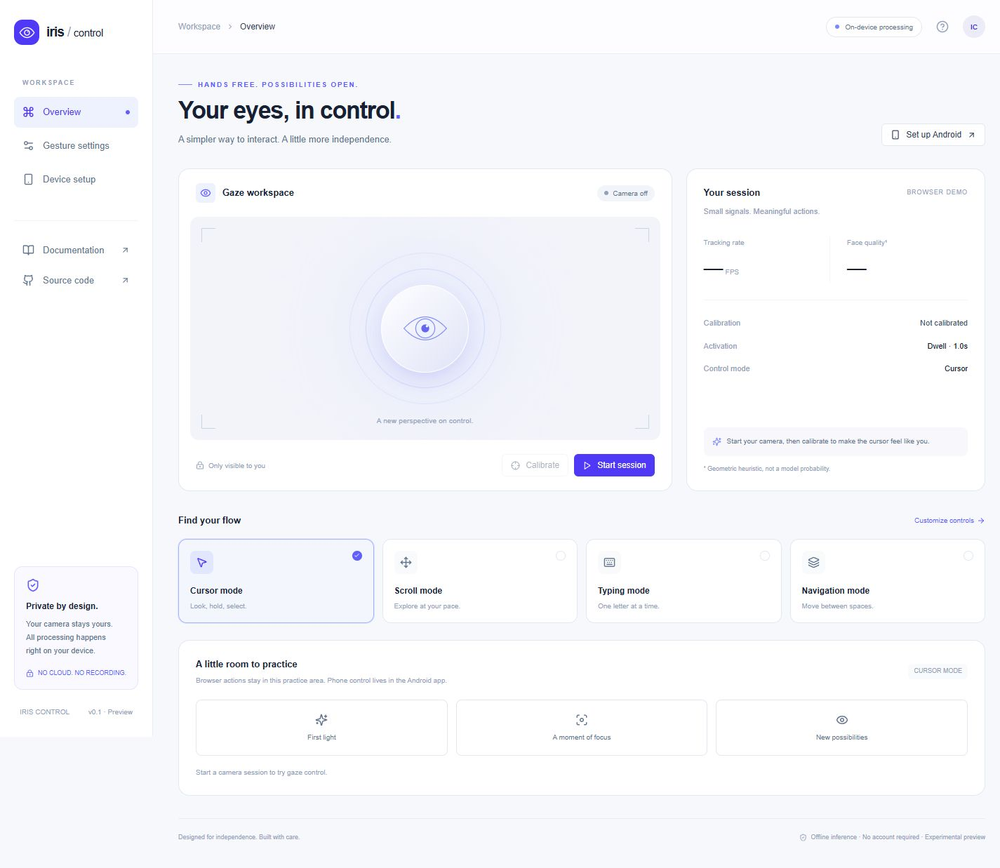

<p align="center"></p>

# Iris Control [DL]

**Your eyes, in control.** An experimental, privacy-first eye and face interface for Windows and Android, with a browser practice mode and an iOS exploration starter.



Iris turns front-camera face and iris landmarks into a calibrated cursor, dwell selections, deliberate blink gestures, Windows mouse/keyboard input, and Android accessibility actions. A minimal **Next.js / React / shadcn-style UI / Tailwind CSS** workspace runs as a browser practice page and inside the Windows Electron controller. The native Windows bridge sends input across ordinary applications and browser pages on the primary monitor. The palette uses indigo, lavender, slate, and white, with no green accents.

**Project type: Deep Learning (DL), within Machine Learning (ML).** MediaPipe's pretrained Face Landmarker performs neural-network inference. Gaze mapping uses classical ridge regression; smoothing and gesture recognition use deterministic algorithms. This is **not a generative AI project**, does not train a new foundation model, and needs no API key.

> **Status: experimental implementation, not a clinically validated or production-certified assistive device.** Unit and build checks do not establish real-world gaze accuracy. Physical-device evaluation is required before relying on actions across apps. See [validation](docs/VALIDATION.md) and [limitations](#limitations-and-roadmap).

## What is included

| Capability | Android controller | Web demo | iOS starter |
|---|---|---|---|
| Front-camera face + iris tracking | CameraX + MediaPipe | MediaPipe WASM, local assets | ARKit face tracking |
| Screen gaze mapping | Saved 9-point calibration | Saved 9-point calibration | Exploratory projection only |
| Cursor and dwell selection | Accessibility overlay + gesture dispatch | Practice tiles and keyboard | App-local cursor |
| Double tap / long press | Deliberate double blink / long blink | Not implemented | Not implemented |
| Swipes and repeated scroll | Edge dwell in Scroll mode | Practice scroll buttons | Not implemented |
| Home / Back / Recents / Notifications / Quick Settings | Gaze-selectable toolbar | Simulated selection feedback | Use system accessibility |
| Typing | Dwell taps on an existing system keyboard | Practice keyboard | Use built-in Eye Tracking |
| Phone-wide control | Android Accessibility Service | **No** — own page only | **No** — custom app cannot inject system taps |
| Fully local inference | Yes; no INTERNET permission | Yes, assets served from same host | Yes |

**Downloads and setup:** [GitHub Releases](https://github.com/vams2krish/iris-control-dl/releases) · [Android / iPhone installation guide](docs/INSTALLATION.md) · [Windows setup and controls](desktop/README.md).

The ordinary browser demo does **not** connect to or remotely operate a phone or Windows. The Windows desktop app is a separate native host for the same UI. There is no account, server database, analytics, image upload, or cloud inference service.

## Getting started

### Windows desktop control across applications

Download the Windows portable ZIP from [Releases](https://github.com/vams2krish/iris-control-dl/releases), extract the whole folder, and run `IrisControl.exe`. Start the camera, run **Calibrate full screen**, then explicitly **Enable desktop actions**. After the three-second delay, switch to Chrome, Firefox, Edge or another desktop app. Gaze moves the real mouse cursor; dwell selects the desktop surface. The top gaze toolbar handles pause/resume, scroll, right/double click, drag/drop, on-screen keyboard, Back, next tab and app switching. **Ctrl+Alt+F8** is the emergency stop.

The desktop host keeps local inference running while another app has focus. It uses a sandboxed renderer, a narrow sender-checked IPC bridge, and a native helper with a stale-frame watchdog. It requires Windows 10/11 x64 and currently supports only the primary monitor. It cannot inject into UAC/lock screens or higher-integrity applications. [Full Windows installation, build and validation details](desktop/README.md).

### Web setup and demo

Requires Node.js 22+ and npm. Installation and asset preparation need internet access; inference does not.

```sh
cd web
npm ci
npm run prepare:vision
npm run dev
```

Open `http://localhost:3000`. Click **Start session**, grant camera access, then **Calibrate**. Look steadily at each dot while samples accumulate. Select practice tiles by holding your gaze; look away to rearm the target. Switch to Typing or Scroll mode to try those practice areas. All practice controls also support mouse, touch, and keyboard activation.

In an ordinary browser, the camera stops when the tab is hidden, the session is stopped, the camera track ends, or the page unmounts. The Windows desktop host keeps tracking while another application has focus and stops it through Stop session or app exit. Browser-demo calibration coefficients and dwell duration are stored in local storage; remove calibration in Gesture settings. Desktop calibration is session-only. Camera frames are never persisted. A browser visited over a non-localhost origin needs HTTPS for camera access.

```sh
npm test
npm run typecheck
npm run build
```

`next build` produces the static `web/out/` directory. Serve that directory at the origin root using any static server; all WASM and model assets are local. No CDN is used at inference time. This version does not include a service worker, so offline reload from a remote host is not guaranteed; use a local server for disconnected operation.

### Android controller

Requires JDK 17, Android SDK platform 36, and an Android 9+ device with a front camera. Android Studio can open `android/` directly. Use a stable mount in **portrait orientation** for this preview.

```sh
python tools/prepare.py
cd android
./gradlew assembleDebug testDebugUnitTest
adb install app/build/outputs/apk/debug/app-debug.apk
```

On Windows, use `gradlew.bat`. If the SDK isn't found, set `ANDROID_HOME` or create an untracked `android/local.properties` with `sdk.dir` pointing to your SDK.

If your system drive is full, set `GRADLE_USER_HOME`, `TEMP`, and `TMP` to directories on a drive with free space before building. The Gradle configuration uses one worker and an in-process Kotlin compiler to limit peak memory; builds still require sufficient RAM and swap. Run Android and web builds sequentially on constrained machines.

1. Open Iris Control. Read the camera and accessibility disclosures.
2. Start the camera and grant camera permission. Allow notifications so the persistent Stop control is easy to find.
3. Run nine-point calibration. Each target has a settling interval and collects 24 valid open-eye observations. Calibration replaces the saved profile only after completion.
4. Open Android Accessibility settings and enable **Iris Control**.
5. Return to the app and explicitly **Enable gaze actions**. Every camera start begins with actions paused.
6. Practice on harmless, large targets. Adjust dwell duration and gesture mappings in the app.
7. Stop from the notification or app to release the camera; use the gaze toolbar to pause actions.

The foreground camera service must be started from the visible activity. It deliberately uses `START_NOT_STICKY`: process death must not silently restart camera access from the background. This differs from the original sticky-service request to respect camera permission and foreground-service lifecycle restrictions. No boot receiver is installed.

### iOS exploration

See [ios/README.md](ios/README.md). The Swift file is a starter to add to an Xcode iOS app; it is not a signed, build-verified Xcode project. For phone-wide eye control, use Apple's built-in **Settings → Accessibility → Eye Tracking** on supported iPhones.

## How it works

```text
Front camera (CameraX / browser MediaStream)
    ↓ latest frame only, bounded inference rate
OpenCV exposure measurement (Android) + MediaPipe Face Landmarker
    ↓ 478 landmarks, iris ratios, eye openness, head-relative offsets
Quality gate → nine-point calibrated ridge regression → EMA cursor filter
    ↓ normalized screen position + confidence heuristic
Temporal gesture engine (Android) / practice-target dwell (web)
    ↓ action + cooldown + fixation rearm
Android AccessibilityService / browser practice area
```

The Android camera frame is rotated upright and mirrored consistently before perception. Gaze features combine both iris positions with two nose-to-face offsets to reduce head-motion interference. This is **not a full 3D head-pose solver or inertial sensor fusion**. The quality score is a geometric/exposure heuristic, not the landmarker model's probability or a validated accuracy measure.

The fit learns two five-coefficient linear maps from four features plus an intercept. Closed-eye and low-quality samples are excluded during calibration, and near-stationary iris features are rejected. Android accelerometer and gyro measurements veto actions during device motion; this is a stability gate rather than a fused 3D pose estimate. No automatic online recalibration runs on unlabelled gaze: that could silently reinforce incorrect targets. Recalibration is explicit in this version.

## Default controls

| Signal | Default action | Accidental-input guard |
|---|---|---|
| Gaze held within normalized radius 0.045 | Single tap after 1000 ms | Once per fixation; gaze must move to rearm |
| Two deliberate blinks, 180–450 ms each | Double tap | Temporal window and 900 ms action cooldown |
| Blink held 850–2200 ms | Long press | Fires after reopening; prolonged occlusion rejected |
| Gaze at an edge in Scroll mode | Directional swipe | Dwell delay, central dead zone, cooldown |
| Top toolbar target | Back / Home / Apps / Alerts / Quick / mode / pause | Consumes selection without a pass-through tap |
| Missing/low-quality face | Suspend actions and hide cursor | Clears pending gesture state |

Short natural blinks do not trigger actions. Deliberate blink thresholds vary by user; the eye aspect ratio threshold is currently fixed and requires device/user testing. The single blink is intentionally unassigned.

Remap dwell, double blink, and long blink in Android settings, or edit [gestures.json](android/app/src/main/assets/gestures.json) for shipped defaults. All `Action` values are supported. Settings persist in app-private preferences. In this version the top toolbar activates via `TAP`; keep dwell mapped to `TAP` for gaze access to that toolbar. A notification Stop control remains available if you choose another mapping.

Typing mode uses calibrated coordinate taps on the installed keyboard. It does not read passwords, inspect text fields, implement an IME, or collect typed content. Small keyboard keys may be too demanding for camera-only gaze estimates. The browser's keyboard is a separate practice surface.

## Performance and privacy

- CameraX keeps only the latest frame and requests roughly 480×360 input. Device aspect ratios can select another supported resolution.
- Single-threaded Android analysis avoids concurrent model calls. Frames are closed in `finally`; native OpenCV and MediaPipe resources close on service shutdown.
- Low/Balanced/Fast frame budgets target 10/20/25 inference attempts per second. Actual FPS is device-dependent and **has not been benchmarked**.
- Android thermal status at severe or above reduces inference attempts to 5 FPS. Adaptive camera rebind/resolution control and battery-aware policies remain future work.
- Face loss suppresses actions. A stale-frame watchdog hides the cursor after 600 ms.
- Android has no network permission, backup is disabled, and no face frames are stored. The accessibility service requests gestures but does not retrieve window content.
- Browser inference assets are served locally; it does not use camera frames as network payloads. The server still receives ordinary asset requests. No cloud inference or remote assets are required after preparation.
- Model files are checksum-verified during preparation and ignored by Git. Model redistribution/licensing must be reviewed separately from this repository's source license.

## Project structure

```text
android/
  app/src/main/java/dev/iris/control/
    camera/          CameraX foreground service, thermal protection
    perception/      MediaPipe features, OpenCV exposure gate
    calibration/     Ridge fit and normalized mapping
    gestures/        Temporal gesture state machine
    accessibility/   Cursor toolbar, gesture/global-action dispatch
    ui/              Compose onboarding, settings, calibration
    Runtime.kt       In-process state and local preferences
  app/src/test/      Gesture and calibration tests
  app/src/main/assets/gestures.json
web/
  app/               Next.js app, responsive workspace
  components/ui/     shadcn-style Radix/CVA button primitive
  hooks/             Local camera + MediaPipe lifecycle
  lib/               Gaze features, calibration, validation
  scripts/           Prepare local WASM and model assets
  tests/             Calibration and storage-validation tests
desktop/             Electron host, native Windows input helper, portable packaging
ios/                 ARKit app-local exploration starter
tools/prepare.py     Verified Android model download
docs/                Validation, test checklist, source references, images
.github/workflows/   Reproducible web and Android checks
```

Modules are organized as Kotlin packages within one Gradle app module so camera, perception, and gesture logic can be swapped without the overhead of a multi-module build. The web demo uses a static export; a cloud backend would add unnecessary exposure and does not enable cross-app control.

## Limitations and roadmap

This implementation is a starting point for iterative assistive-technology evaluation, not a finished replacement for tested platform accessibility features.

- **Physical validation:** gaze accuracy, blink robustness, latency, 20–25 FPS, battery impact, glasses, diverse faces, camera contention, and OEM service behavior still need broader hardware testing. A Pixel 4a (5G), Android 14, was subsequently used for install/startup checks, with user-confirmed face detection, calibration and cursor visibility. Task-accuracy evaluation remains outstanding.
- **Full-phone limits:** Android protected screens, lock screen, secure flows, OEM restrictions, physical navigation changes, and some custom keyboards may reject or misinterpret injected gestures. No root bypass is attempted.
- **Orientation:** portrait/stable placement only in this preview. Rotating, moving the phone, or changing posture requires pausing and recalibrating. Automatic rotation/profile handling is planned.
- **Calibration:** ridge mapping can produce poor results when features scarcely vary. Add independent validation targets and residual/error scoring before production use. There is no online drift correction yet.
- **Vision:** no dedicated ONNX/L2CS gaze estimator, pupil morphological refinement, calibrated uncertainty model, or accelerometer/gyro fusion yet. OpenCV currently measures exposure without changing RGB model input.
- **Gestures:** no optional head nod/shake recognizer, drag-and-drop, pinch, or multitouch gesture editor. Blink thresholds are fixed in perception code.
- **Typing:** no swipe typing or language prediction. Continuous keyboard-path dispatch requires careful explicit start/end control and keyboard compatibility testing.
- **Modes:** Android Cursor and Typing currently share dwell behavior; Navigation uses the same toolbar available in all modes. Browser navigation tiles provide selection feedback only.
- **Recovery:** gaze pause is supported, but resuming paused Android actions requires the app. Consider a separate deliberate resume gesture with usability testing.
- **iOS:** app-local ARKit projection only; built-in Eye Tracking and AssistiveTouch/Switch Control provide the system integration path. No private APIs are used.
- **Release readiness:** add instrumented tests, accessibility/user studies, distribution-policy review, signed release builds, and sustained thermal/power profiling. Do not claim medical efficacy.

## Testing and references

- [Platform installation and run steps](docs/INSTALLATION.md)
- [Windows desktop controller](desktop/README.md)
- [Test checklist](docs/TESTING.md)
- [Validation record](docs/VALIDATION.md)
- [Official technical references](docs/REFERENCES.md)
- [iOS setup and platform integration](ios/README.md)

Source code is licensed under [MIT](LICENSE). Third-party libraries, models, icons, and generated build artifacts retain their respective terms. MediaPipe/Google AI Edge, OpenCV, AndroidX, Next.js, React, Tailwind, Radix UI, and Lucide power the implementation.
